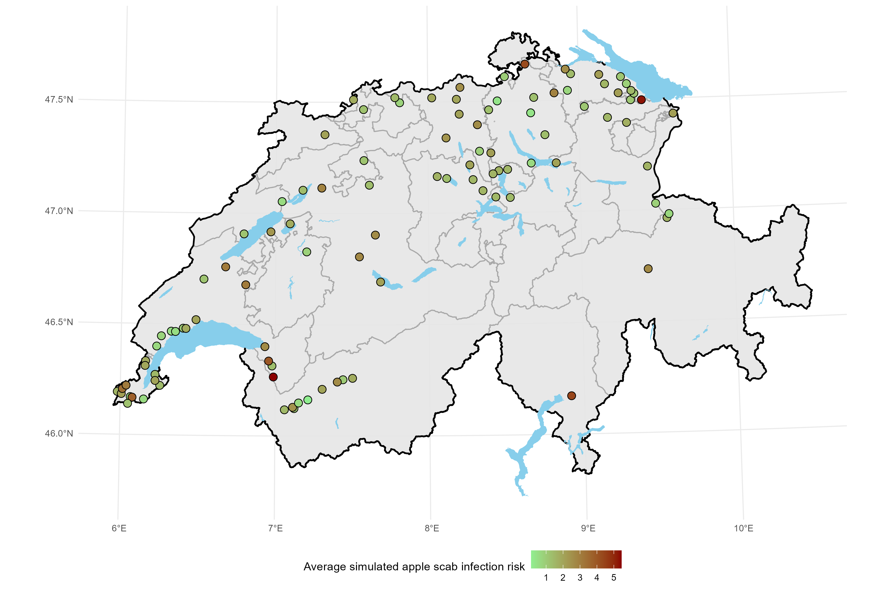
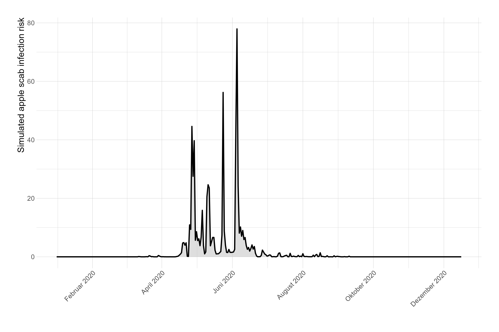

# Agrometeo: Data access and transformation
This repository contains material for accessing the data at [https://www.agrometeo.ch/de](https://www.agrometeo.ch/de) and converting it to machine-readable formats. This makes it possible to convert and visualize the data, which is only available in PDF formats, as shown below in the example of simulated data on apple scab infection risk.

### Spatial visualization 

### Time series

## Prerequisites
For the use of the material make sure to have a owrking version of both R and Pyhton installed. 

## Material
This repo consists of these main files:
1. 1_DownloadAgrometeoPDF.R in 1_code: File to batch download PDFs
2. 2_ExtractPDF.py in 1_code: Python script to convert the PDFs into CSV files
3. 3_DataAggregation.R in 1_code: Script to aggregate and visualize data
3. 2_data: Folder with data, such as PDFs and CSV files
4. 3_output: FOlder with generated plots

## User guide
First, fork it to your local machine. Second, open *AgrometeoScab.Rproj*. Third, open *1_DownloadAgrometeoPDF.R*, specify the url and year and follow the script. This will, download and transfer the PDFs to their home (in the 2_data folder). Forth, run the 2_ExtractPDF.py file. Last, use 3_DataAggregation.R to aggregate and visualize the data. 

### Author: 
Lucca Zachmann (lzachmann[at]ethz.ch)  
**ETH Zürich**, Agricultural Economics and Policy Group